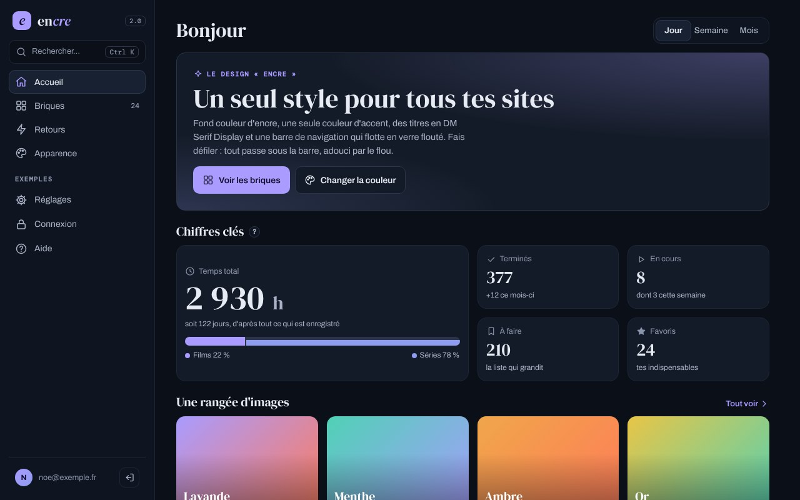
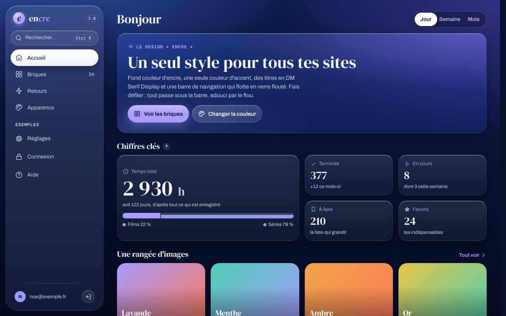
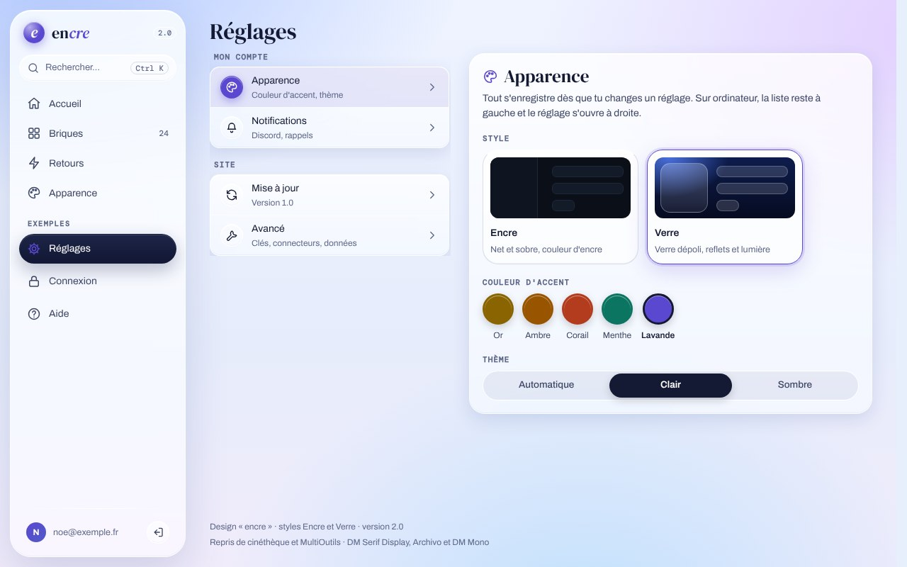
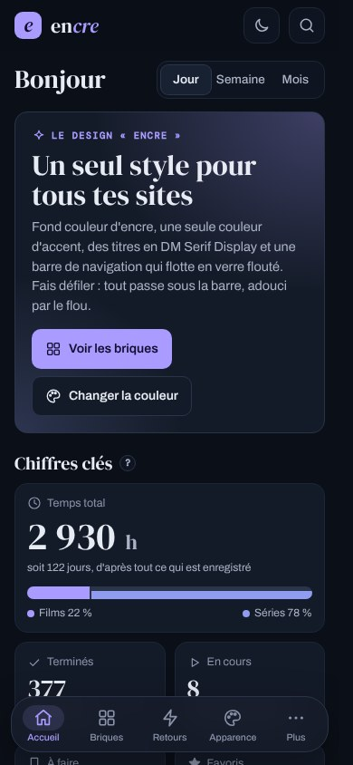
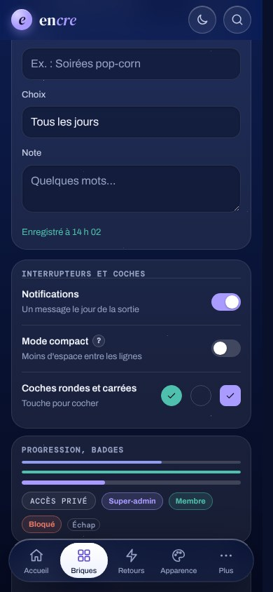
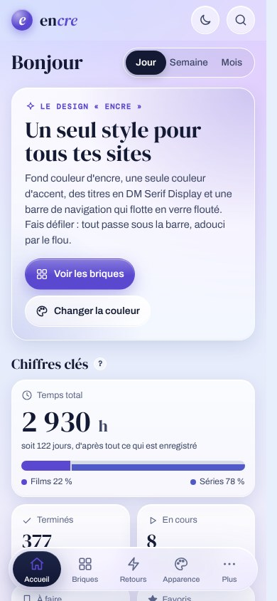

# Kit de design « encre » 2.0 : styles Encre et Verre

Tout pour construire n'importe quelle page dans le design de Noë : site
responsive (ordinateur, tablette, téléphone), application Windows ou Mac,
deux styles (**Encre** et **Verre**), trois thèmes (automatique, clair,
sombre) et cinq couleurs d'accent.

**Pour une IA ou un développeur, dans cet ordre :**

1. [`CONSIGNES-IA.md`](CONSIGNES-IA.md) : le contrat du design en une page.
2. [`LISEZMOI.md`](LISEZMOI.md) : le guide complet (couleurs, briques,
   comportements, responsive, appli Windows / Mac, téléphone, vérifications).
3. `demo.html` : toutes les briques en vrai (ouvrir dans un navigateur).
4. `modele.html` : le squelette à copier pour commencer.

**Tout le dossier en un fichier :**
[kit-design-encre-verre.zip](../kit-design-encre-verre.zip) (bouton
« Download raw file » / « Télécharger » sur GitHub).

| Encre sombre | Verre sombre | Verre clair |
|---|---|---|
|  |  |  |

| Téléphone, Encre | Téléphone, Verre sombre | Téléphone, Verre clair |
|---|---|---|
|  |  |  |
